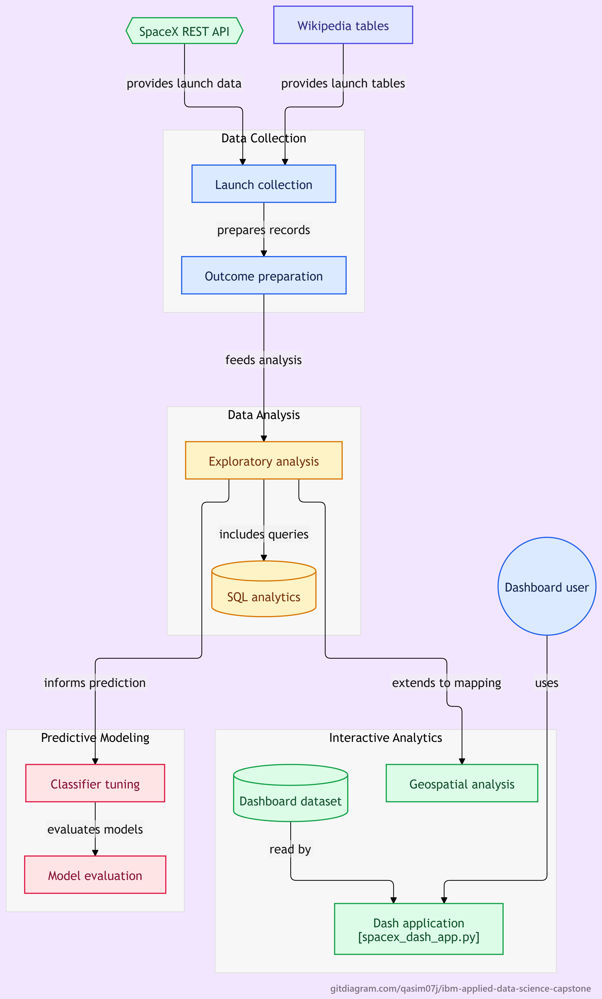

# SpaceX Falcon 9 First Stage Landing Prediction
### IBM Applied Data Science Capstone Project
**Author:** Muhammad Qasim  
**Repository:** [https://github.com/QASIM07J/IBM-Applied-Data-Science-Capstone](https://github.com/QASIM07J/IBM-Applied-Data-Science-Capstone)  
**Track:** Commercial Space Launch Optimization  

---

## Executive Summary

SpaceX advertises Falcon 9 rocket launches at **$62 million**, substantially lower than the commercial launch market average of **$165+ million**. This substantial 60%+ cost advantage is driven by SpaceX's ability to recover and reuse the first stage booster. 

In this capstone project, we build a full data science pipeline to predict whether the Falcon 9 first stage will land successfully (`Class = 1`) or be lost (`Class = 0`). By determining the probability of a successful booster landing based on flight parameters (payload mass, launch site, target orbit, booster serial, and launch year), commercial launch providers and competitors can evaluate launch economics and price competitive launch bids with data-driven confidence.

<p align="center">
  
</p>

---

## Methodology & Architecture

The project follows a standard end-to-end data science lifecycle:

```
[ SpaceX REST API & Wikipedia ] 
              │
              ▼
[ Data Wrangling & Cleaning ] ──► Outcome Labeling (Class 0/1) & One-Hot Encoding
              │
              ▼
[ Exploratory Data Analysis ] ──► Matplotlib/Seaborn & Relational SQL Queries
              │
              ▼
[ Interactive Visual Analytics ] ──► Folium Geospatial Maps & Plotly Dash Web App
              │
              ▼
[ Predictive Machine Learning ] ──► Hyperparameter Tuning (GridSearchCV) & Evaluation
```

### 1. Data Collection
- **SpaceX REST API**: Querying official SpaceX v4 endpoints (`/launches/past`, `/payloads`, `/launchpads`, `/cores`) to extract raw telemetry for 90 verified Falcon 9 flights while excluding suborbital and Falcon 1 developmental tests.
- **Web Scraping**: Extracting historical launch tables from Wikipedia using `BeautifulSoup4` (`wikitable plainrowheaders`) to capture supplemental records and resolve historical outcome classifications.

### 2. Data Wrangling
- Handled missing values by imputing mean payload mass (**6,123.55 kg**).
- Engineered the binary target feature `Class`:
  - `1`: Successful recovery (`True ASDS` on drone ship or `True RTLS` on ground pad).
  - `0`: Failed or uncontrolled re-entry (`False ASDS`, `False RTLS`, `None ASDS`, `None None`).
- Applied One-Hot Encoding across categorical features (`Orbit`, `LaunchSite`, `LandingPad`, `Serial`), yielding 83 numerical predictor features.

### 3. Exploratory Data Analysis (EDA)
- **Data Visualization (`matplotlib`, `seaborn`)**:
  - Investigated flight number progression vs. launch sites, payload mass distribution, and orbital success densities.
  - Tracked the temporal learning curve: booster recovery success grew steadily from **0% in 2010** to **33% in 2014**, surpassing **67% in 2017**, and reaching over **85% by 2020**, confirming hardware and algorithmic maturity.
- **Relational SQL Database Analytics (`SQLite` / `SPACEXTBL`)**:
  - Executed 10 business queries identifying launch counts by site (Cape Canaveral CCAFS SLC-40 hosting 55 launches), total NASA payload mass (99,965 kg), first ground recovery date (2015-12-22), maximum payload missions (15,600 kg on reusable Block 5 boosters), and landing outcome rankings.

### 4. Interactive Visual Analytics
- **Folium Geospatial Mapping**:
  - Mapped launch complexes (`CCAFS SLC-40`, `KSC LC-39A`, `VAFB SLC-4E`) with color-coded marker clusters (green for success, red for failure).
  - Calculated Haversine proximities to coastlines (0.5–1.2 km for downrange safety), railways (1.2–1.8 km for stage logistics), highways (0.8–1.5 km), and urban population centers (>25 km acoustic/safety buffer).
- **Plotly Dash Interactive Dashboard (`spacex_dash_app.py`)**:
  - Reactive single-page web app with a launch site selector and payload range slider.
  - Dynamically updates a success rate pie chart and a payload vs. launch outcome scatter plot.

### 5. Machine Learning & Predictive Modeling
Tuned four supervised classification algorithms using **GridSearchCV** with 10-fold cross-validation:

| Algorithm | Best Hyperparameters | Cross-Validation Score | Test Accuracy (18 Samples) |
|:---|:---|:---:|:---:|
| **Logistic Regression** | `C=0.01`, `penalty='l2'`, `solver='lbfgs'` | 84.64% | **83.33%** |
| **Support Vector Machine (SVM)** | `C=1.0`, `gamma=0.03`, `kernel='sigmoid'` | 84.82% | **83.33%** |
| **Decision Tree Classifier** | `criterion='gini'`, `max_depth=4`, `splitter='best'` | **87.14%** | **83.33%** |
| **K-Nearest Neighbors (KNN)** | `n_neighbors=10`, `p=1`, `algorithm='auto'` | 84.82% | **83.33%** |

#### Confusion Matrix Insights
Across test data (18 observations), all four models demonstrated identical evaluation metrics:
- **True Positives (12):** Correctly predicted landing successes.
- **True Negatives (3):** Correctly predicted landing failures.
- **False Positives (3):** Failed missions misclassified as successful.
- **False Negatives (0):** Zero misses on successful landings (100% recall for landing success).

> **Selected Model:** The **Decision Tree Classifier** is recommended for production deployment due to its superior cross-validation score (87.14%), transparency, and interpretable decision rules.

---

## Repository Structure

```
├── Data Science Capstone Project Report.pdf    # Comprehensive 8-page Capstone Presentation Report
├── diagram.png                                 # End-to-end pipeline & system architecture diagram
├── spacex_dash_app.py                          # Modern SpaceX Mission Control Plotly Dash dashboard
├── spacex_launch_dash.csv                      # Dataset supporting the Dash application
├── assets/                                     # Custom CSS & Space-grade Mission Control theme
│   └── custom.css                              # Glassmorphism, animations, and custom UI/UX styling
├── Data_Collection_Web_Scraping.ipynb          # Web scraping Wikipedia launch records
├── EDA_Data_Visualization.ipynb                # Exploratory Data Analysis & visual discoveries
├── Interactive_Visual_Analytics_Folium.ipynb   # Geospatial mapping & proximity analysis
└── README.md                                   # Project documentation and summary
```

---

## Running the Dashboard Application

To launch the interactive Dash application locally:

```bash
# 1. Install dependencies
pip install dash pandas plotly

# 2. Run the application
python spacex_dash_app.py
```

Open your browser and navigate to `http://127.0.0.1:8050/`.

---

## Conclusion & Business Impact

1. **Launch Site Geography:** Cape Canaveral (CCAFS SLC-40) and Kennedy Space Center (KSC LC-39A) handle the majority of missions, with KSC LC-39A achieving the highest individual success rate (76.2%).
2. **Payload Envelope:** Missions with payload masses between 2,000 kg and 5,500 kg show optimal recovery probability across drone ship (ASDS) and landing pad (RTLS) recoveries.
3. **Competitive Strategy:** Any commercial space launch competitor bidding against SpaceX must anticipate a base **83%+ booster recovery rate**, dictating an aggressive price-performance threshold to remain commercially viable.

---

## Author

- **Muhammad Qasim**
- LinkedIn / GitHub: [@QASIM07J](https://github.com/QASIM07J)
- Program: IBM Data Science Professional Certificate / Applied Data Science Capstone
